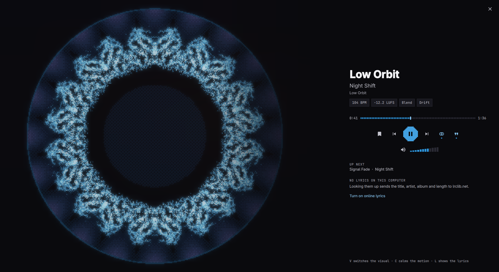

# Halo



A music player for Omarchy. Halo plays the music on your disk, analyses
every song once for its tempo and loudness, and uses that to play your
library the way a DJ would: songs blend into each other on the phrase, the
queue never has to run out, and a loud mixtape sits next to a quiet album
at the same level. Nothing leaves your computer. The window follows your
Omarchy theme and language.

What [DISCLOSURE.md](DISCLOSURE.md) says Halo reads, writes and runs is
checked against the source.

## What it does

- **Blend.** Instead of a fixed crossfade, Halo mixes for eight beats at the
  outgoing song's tempo, starting where its music really ends rather than at
  its last second, and skipping the next song's silent lead-in. Halfway
  through, the bass swaps: the outgoing song's lows are filtered away as the
  incoming song's arrive, so two kick drums never pile up. Turn Blend off
  (B) for exact gapless playback, sample for sample.
- **Drift.** When the queue runs out, Halo keeps going from your library,
  picking songs close in tempo (half and double time count) and loudness,
  not played recently, and preferably from another album. Songs Drift adds
  are marked with a wave in the queue.
- **Moments.** Press M to pin the second you are hearing: the drop, the verse,
  the start of a song inside an hour-long mixtape. Moments are ticks on the
  seek bar, `[` and `]` jump between them, and the Moments view replays any of
  them.
- **The halo.** The visual is drawn from the song itself (Halo's own FFT of
  what it plays, not every sound on the machine) as a ring of square pixels
  around the cover in your theme's accent, torn sideways for a frame on hard
  beats. V cycles to LED bars, then to the kaleidoscope: a mirrored fractal
  in square pixels that belongs to the song playing. The file decides it:
  the song picks its mirrors (5 to 12) and shape, the album its colours (so
  an album's songs belong together), the tempo its turn (one mirror every
  eight beats, locked to the beat), the length a path the shape travels
  across the song, the loudness its glow. Live, each beat clicks the inner
  pattern round and punches the view in, the bass turns it further and the
  mids make it wobble. A new song's mirrors crossfade in.
  Visuals crossfade as V switches them. C keeps any of them still.
- **The window is water.** Behind everything lies a pond of square pixels
  with drifting caustics. Every beat drops a ripple (from the cover, or
  somewhere on the surface), every click anywhere in the window drops one
  where you clicked, and the pointer leaves a soft wake. The rings spread,
  cross and fade, and bend the stars and rain under them. It is kept dim
  enough that the faintest text over it still reads at 7:1, it rests when
  nothing is playing or rippling, and C stills it.
- **Smooth motion.** Everything moves on the display's own frame clock with
  eased curves: pages surface with a fade and a lift, Now Playing and the
  shortcut sheet rise and settle, covers fade up as they load and crossfade
  when the song changes, album tiles drift into place, queue rows slide, and
  a mouse wheel glides (touchpads still move 1:1).
- **Live lyrics.** Press L. Timed lyrics scroll with the song and fill in
  word by word in your accent, a block cursor riding the edge of the word
  being sung; each new line decrypts into place, and long breaks count down
  in pixels. Click a line to jump to it; scroll to read ahead. Lyrics come
  from a `.lrc` file beside the song, its tags, or (only if you turn it on)
  [LRCLIB](https://lrclib.net), the free lyrics database, which has word
  timing for many songs. If the timing is off, `,` and `.` shift it for that
  song, and Halo remembers. See [DISCLOSURE.md](DISCLOSURE.md) for exactly
  what a lookup sends.
- **Pixel glitch, Omarchy style.** Halo borrows the screensaver's look: a
  pixel wordmark, titles that decrypt into place through block shades, and a
  pixel-and-slice glitch as the window opens. C (calm) turns the motion off.
- **DJ tapes read right.** When a tape tags the host as every track's artist
  and puts the credit in the title ("10 Mack Maine - Young Mulah Baby"), the
  performer becomes the artist and the host stays the album artist.
- **Even loudness.** Every song is measured with ffmpeg's EBU R128 meter
  (ITU-R BS.1770 loudness and 4x oversampled true peak) and brought to
  -14 LUFS, but never boosted past -1 dBTP, so the limiter is left for
  blends and EQ boosts.
- **Lost & Found** (6). Songs you played often and haven't heard in six
  weeks or more, weighted toward the most loved and the longest gone, new
  each day. Until there's that much history, songs you've never played.
- **Library Doctor** (7). Finds site names stamped into tags ("[DatPiff.com]"),
  track numbers left in titles, missing titles, artists and albums, album
  artists that disagree within an album, and the same song kept twice. Each
  fix comes from the file's own tags, file name and folder, is shown as
  before and after, and is written only when you press Fix. Every fix is
  logged and U undoes it; a file that changed since the check is never
  overwritten. Duplicates are only pointed out, never deleted.
- **Headphone correction, by itself.** When the output changes, Halo looks
  its name up among 6,229 headphones measured by oratory1990, crinacle,
  Rtings and others (OPRA's dataset, which includes AutoEQ's) and, on an
  exact match, makes them neutral before your EQ. Bluetooth and USB
  headphones name themselves; ones in a headphone jack can't be told apart.
  Nothing is looked up online. E shows it and turns it off per device.
- **Clean output.** Songs that aren't 48 kHz are resampled with soxr (alias
  products at -159 dB). The output limiter looks 1.6 ms ahead and detects
  peaks between samples: it holds -1 dBTP with distortion under -87 dB even
  on loud bass, and quiet music passes through bit for bit.
  `tools/audio-lab/` measures both.
- **Equalizer.** Ten bands, a preamp and presets, with the limiter behind it.
- **Sleep timer.** Fades out over fifteen seconds and pauses (Z).
- **Most played.** Counted on this computer when you hear half a song.
- **Every bar widget is a remote.** Halo speaks MPRIS, so media keys, the
  Omarchy bar, and the now-playing widgets on the plugin marketplace control
  it.
- **Agents can drive it.** `halo status --json`, `halo add <folder>`,
  `halo analyze <file> --json` and more; `halo skill install` teaches coding
  agents how.


## Your music

Halo reads `~/Music`, and any more folders listed one per line in
`~/.config/halo/folders`. A folder is an album, which is how mixtapes, rips
and downloads are laid out; a `CD1` or `Disc 2` folder joins its parent.
Covers come from an image in the folder or from the files' tags. Files
shorter than ten seconds (drum one-shots, sample packs) stay out of the
library, and a folder holding a `.haloignore` or `.nomedia` file is skipped.
Drop files or folders on the window to play them.

Halo never changes, moves or deletes a music file.

## Keys

| Key | Action |
| --- | --- |
| Space | Play or pause |
| N, P | Next or previous song |
| Shift+Left, Shift+Right | Back or forward 10 seconds |
| `-`, `=` | Volume down or up |
| Enter | Play the selected song or album |
| Shift+Enter | Play the selected song next |
| A | Add the selected song to the queue |
| `/`, Ctrl+F | Search |
| 1 to 7 | Albums, Songs, Queue, Moments, Most played, Lost & Found, Library Doctor |
| U | Undo the last fix (in the Library Doctor) |
| F | Now Playing, full window |
| L | Lyrics, live with the song (opens Now Playing) |
| `,`, `.` | Lyrics 0.1 s earlier or later for this song (with Shift: 0.5 s) |
| M | Save a moment at this second |
| `[`, `]` | Previous or next moment |
| B | Blend on or off |
| D | Drift on or off |
| S, R | Shuffle, repeat (off, all, one) |
| E | Equalizer |
| Z | Sleep timer: 15, 30, 60, 90 minutes, off |
| V, C | Switch the visual, calm the motion |
| Delete | Remove the selected song from the queue |
| Alt+Up, Alt+Down | Move a song in the queue |
| Ctrl+Z, Ctrl+Shift+Z | Undo and redo queue changes |
| Ctrl+R | Look for new music |
| ? | Show every shortcut |
| Q | Quit |

## From a terminal

```sh
halo open ~/Music/SomeAlbum     # play a folder (or files)
halo status                     # what is playing and the library scan; --json for scripts
halo add song.flac ; halo playnext ~/Music/Other
halo next ; halo pause ; halo seek +30 ; halo volume 60
halo blend on ; halo drift off ; halo repeat all ; halo sleep 30
halo lyrics                     # the words of the song playing, the sung line marked
halo lyrics online on           # look lyrics up on lrclib.net (off by default)
halo lyrics offset +0.3         # this song's lyrics 0.3 s earlier
halo analyze track.mp3 --json   # tempo, loudness, where the music starts and stops
halo scan                       # what is in your music folders, no window needed
halo skill install              # a skill for coding agents
```

Every command takes `--json` and exits 0 on success or 1 with the error on
stderr.

## Build

Halo is C++ and Qt Quick, built with qmake into one binary. It needs Qt 6
(base, declarative, multimedia, wayland), TagLib and ffmpeg, all in Arch's
repositories and all but TagLib already part of Omarchy. Building also needs
`qt6-shadertools` for `qsb`, which compiles the glitch shader into the binary.

```sh
bin/build      # build/halo
bin/test       # the Qt Test suite, offscreen
bin/install    # makepkg -fsi: installs halo, its icon and launcher entry
```

After `bin/install`, Halo is in the app launcher (Super+Space).

## How it works

- Each song is decoded by its own `ffmpeg` process into 48 kHz floats on a
  pipe. A thread copies them into a six-second ring only while the ring has
  room, so the pipe fills and ffmpeg waits: an hour-long mix is never decoded
  into memory.
- The audio callback mixes two decks with no locks and no allocation: the
  window posts commands to a lock-free queue the callback drains. Gapless
  hand-over happens inside the callback, on the next sample.
- Analysis decodes each song once at the lowest CPU priority: ffmpeg's
  ebur128 meter takes loudness and true peak from the song as it is, and a
  22 kHz mono copy feeds the rest. Tempo comes from the autocorrelation of a
  spectral-flux onset envelope, with a prior toward 120 BPM and a check that
  the beat stands out; silent edges are found in 50 ms windows.
- Tags, durations and embedded covers come from TagLib. The library is
  cached and rescanned only where files changed.

## Licence

MIT. See [LICENSE](LICENSE). The theme and language plumbing follows Omacut
and Monologue (MIT, David Heinemeier Hansson). The icons are paths from
Google's Material Design icons (Apache 2.0).
