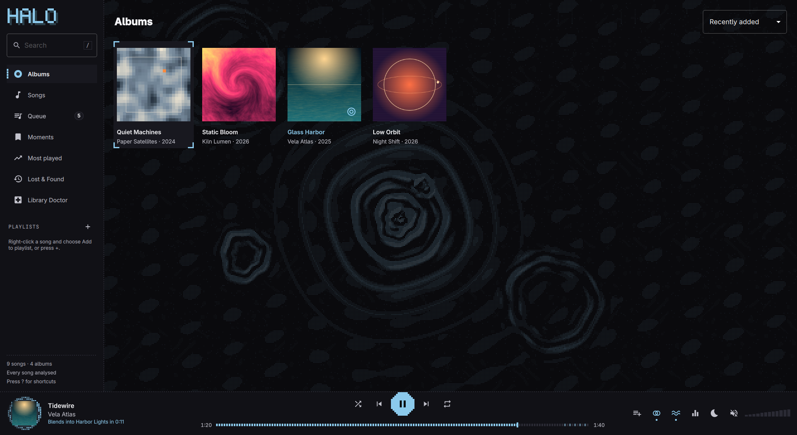
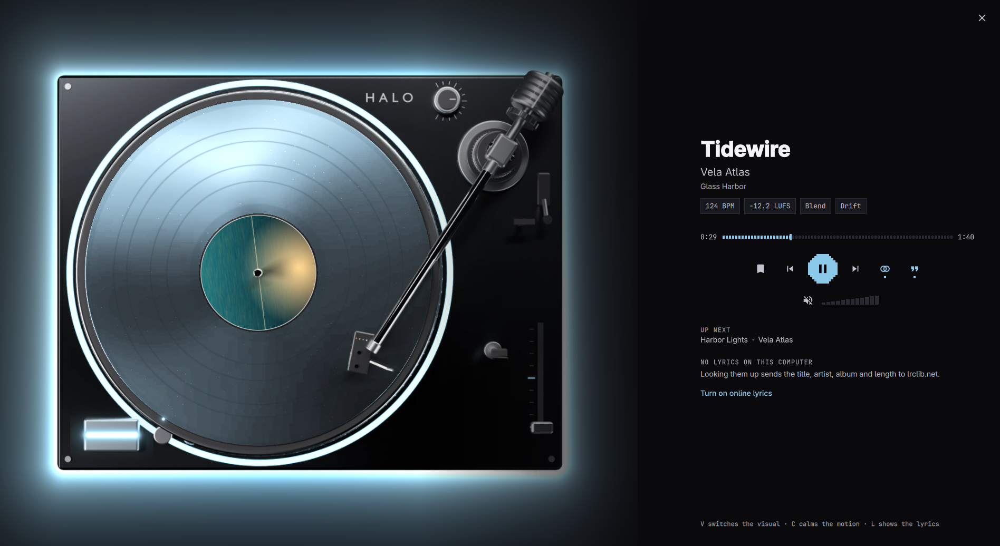

# CymtX


**See it move:** [ten seconds of Cymatics](https://github.com/Tiedeyez/cymtx/releases/download/v1.1.0/cymtx-cymatics.mp4) (a made-up demo song, no sound).

Music you can see. CymtX (say "cymatics") is a music player for Omarchy
built round one idea: sound has a shape. Scatter sand on a metal plate, play
a note into it, and the sand walks into a figure; change the note and it
walks into another. CymtX does that to every song, for real: it works out
how a round plate rings to the music it is playing and where thousands of
grains of sand would go, and draws the result in square pixels, mirrored
into a mandala that is never the same twice.

Under the picture it is a full player. It plays the music on your disk,
analyses every song once for its tempo and loudness, and uses that to play
your library the way a DJ would: songs blend into each other on the phrase,
the queue never has to run out, and a loud mixtape sits next to a quiet
album at the same level. Nothing leaves your computer. The window follows
your Omarchy theme and language.

CymtX was called Halo until version 1.1.0. It is the same player: the first
time it starts it takes a copy of Halo's settings, queue, playlists and
analysis, and a `halo` command still works.

What [DISCLOSURE.md](DISCLOSURE.md) says CymtX reads, writes and runs is
checked against the source.

## What it does

- **Cymatics.** The picture is worked out, not drawn. Four things happen
  sixty times a second:
  - *The plate.* A thin round plate, free at its edge, can only ring in
    certain shapes, each with its own pitch: rings, spokes, and lattices of
    both (the solutions of the Kirchhoff-Love plate equation, built from
    Bessel functions; CymtX solves the free-edge condition for them, and
    its numbers are tested against the published table in Leissa's
    *Vibration of Plates*). CymtX's plate has its lowest ring at 55 Hz and
    its finest lattice near the top of hearing.
  - *The music.* Each shape is a resonator that answers the part of the
    spectrum at its own pitch, a treble shape in a few milliseconds, a bass
    one in a few hundredths of a second, and each is measured against what
    it usually hears, so a kick drum, a hi-hat and a voice each get the
    plate for their moment. Nothing is smoothed first: the plate hears the
    spectrum as it was measured this frame.
  - *The sand.* Thousands of grains are thrown about where the plate moves
    and lie where it is still, so they walk downhill to the quiet places.
    Sand takes up room, so it fills those places like water fills a basin
    instead of standing on one point. Below the loudness that would lift a
    grain off the plate nothing moves; a beat is a blow that throws all of
    it into the air for a moment.
  - *The mandala.* The shapes used share their spokes, so the plate's
    motion repeats round the centre and mirrors across each spoke, and the
    sand's with it. How many times it repeats (5 to 12) comes from the
    song, the same every time you play it.
  Under the sand the bare plate glows where it is moving. In a wide window
  the plate sits on the song's side, clear of the text.

- **Blend.** Instead of a fixed crossfade, CymtX mixes for eight beats at the
  outgoing song's tempo, starting where its music really ends rather than at
  its last second, and skipping the next song's silent lead-in. Halfway
  through, the bass swaps: the outgoing song's lows are filtered away as the
  incoming song's arrive, so two kick drums never pile up. Turn Blend off
  (B) for exact gapless playback, sample for sample.
- **Drift.** When the queue runs out, CymtX keeps going from your library,
  picking songs close in tempo (half and double time count) and loudness,
  not played recently, and preferably from another album. Songs Drift adds
  are marked with a wave in the queue.
- **Moments.** Press M to pin the second you are hearing: the drop, the verse,
  the start of a song inside an hour-long mixtape. Moments are ticks on the
  seek bar, `[` and `]` jump between them, and the Moments view replays any of
  them.
- **The visuals.** Every visual is drawn from the song itself (CymtX's own FFT
  of what it plays, not every sound on the machine). The first, **Ring**, is a
  ring of square pixels around the cover in your theme's accent, torn sideways
  for a frame on hard beats. V cycles to LED bars, then to the kaleidoscope: a mirrored fractal
  in square pixels that belongs to the song playing. The file decides it:
  the song picks its mirrors (5 to 12) and shape, the album its colours (so
  an album's songs belong together), the tempo its turn (one mirror every
  eight beats, locked to the beat), and the loudness its glow. Its design
  holds for eight bars, then morphs into a song-seeded design over the last
  bar. Each beat punches the view in, flashes its lines, and sends a
  shockwave out; it doesn't swap the design. A new song's mirrors crossfade
  in. Its layers take turns in the theme's accent, magenta and bright cyan,
  anti-aliased four samples a pixel so the shapes stay crisp.
  Then six more, all in square pixels and your theme's colours: **Skyline**
  (a mirrored spectrum over a rippling reflection, bass in the middle),
  **Phosphor** (an oscilloscope trace with afterglow), **Pulsar** (stacked
  ridge lines of the spectrum), **Waterfall** (a scrolling spectrogram),
  **Warp** (flying through stars, faster as the music gets louder),
  **Aurora** (curtains of light with rays). Then two drawn at the screen's
  full resolution: **Turntable** (a deck rendered in Blender, seen face
  up, with the album cover turning on the label and the tonearm following
  the song) and **Hologram** (the Turntable's
  deck made of light and energy: every edge a line of light with faint
  x-ray lines of the parts behind, the grooves carrying the spectrum, a
  shockwave on each beat, the album cover turning on the label as light,
  and the tonearm following the song). And **Cymatics**, the one CymtX is named for and
  the one it opens with.
  In Now Playing, the active visual fills the window behind the song and
  lyrics; a soft window-colour scrim keeps the text at WCAG AAA contrast.
  Ring, Bars, Kaleidoscope, Turntable and Hologram grow beyond the window
  edges, while Cymatics and the six square-pixel visuals fill the whole window.
  In a wide window the visuals with a middle (Skyline's bass, Pulsar's
  peak, Warp's vanishing point) put it on the song's side, clear of the
  text.
  Cover art stays in the centre of Ring and Kaleidoscope, stands on top of
  the Bars, and turns on the label of Turntable and Hologram.
  The spectrum is measured in decibels, so a loud, compressed master holds
  every band near the top; the pixel visuals take off a floor that follows
  the music's own average, so its peaks still stand out instead of the
  picture filling to a solid block.
  The pixel visuals are lit like a wall of LEDs in a dark room: each cell
  brighter in its middle, the hottest burning white, light blooming onto
  their neighbours and lifting on the kick. Bars stand on a glossy floor
  that reflects them.
  On Turntable and Hologram the record player works: drag the fader for
  the volume, turn the dial (drag up or down, or scroll) for the EQ's gain,
  press start/stop to play and pause, and take the tonearm's headshell and
  drop the needle anywhere on the record to move through the song.
  Visuals crossfade as V switches them, and the name shows for a moment.
  C keeps any of them still. `cymtx visual <name>` switches from a terminal.
- **The library is the same plate.** Behind the library views one plate
  larger than the window lies under everything: the same sand, in your
  accent, dim enough that the faintest text over it still reads at 7:1,
  lifting for the moment of a beat. A click anywhere knocks the plate
  there and the sand jumps. It rests when nothing is playing or settling,
  and C stills it. Now Playing gives that background to the active visual
  instead.
- **Smooth motion.** Everything moves on the display's own frame clock with
  eased curves: pages surface with a fade and a lift, Now Playing and the
  shortcut sheet rise and settle, covers fade up as they load and crossfade
  when the song changes, album tiles drift into place, queue rows slide, and
  a mouse wheel glides (touchpads still move 1:1).
- **Live lyrics.** Press L. Timed lyrics scroll with the song and fill in
  word by word in your accent, a block cursor riding the edge of the word
  being sung; each new line decrypts into place, and long breaks count down
  in pixels. Click a line to jump to it; scroll to read ahead. Lyrics come
  from a `.lrc` file beside the song, its tags, or (only if you turn it on)
  [LRCLIB](https://lrclib.net), the free lyrics database, which has word
  timing for many songs. If the timing is off, `,` and `.` shift it for that
  song, and CymtX remembers. See [DISCLOSURE.md](DISCLOSURE.md) for exactly
  what a lookup sends.
- **Pixel glitch, Omarchy style.** CymtX borrows the screensaver's look: a
  pixel wordmark, titles that decrypt into place through block shades, and a
  pixel-and-slice glitch as the window opens. C (calm) turns the motion off.
- **DJ tapes read right.** When a tape tags the host as every track's artist
  and puts the credit in the title ("10 Mack Maine - Young Mulah Baby"), the
  performer becomes the artist and the host stays the album artist.
- **Even loudness.** Every song is measured with ffmpeg's EBU R128 meter
  (ITU-R BS.1770 loudness and 4x oversampled true peak) and brought to
  -14 LUFS, but never boosted past -1 dBTP, so the limiter is left for
  blends and EQ boosts.
- **Lost & Found** (6). Songs you played often and haven't heard in six
  weeks or more, weighted toward the most loved and the longest gone, new
  each day. Until there's that much history, songs you've never played.
- **Library Doctor** (7). Finds site names stamped into tags ("[DatPiff.com]"),
  video and upload labels ("(Official Video)"), track numbers left in
  titles, missing titles, artists, albums and track numbers, tags that say
  nothing ("Unknown Artist", "Track 07"), one artist spelled two ways, an
  album or album artist that disagrees within a folder, names in all
  capitals, and the same song kept twice. Each fix comes from the file's own
  tags, file name and folder, and is shown as before and after. **Fix all**
  writes only the fixes that are certain; the rest say where they come from
  and are yours to check, one song or one folder at a time, and where
  nothing on the computer has the answer you can type it once for the
  folder. A folder that is a pile of loose songs (Downloads, the music
  folder itself, a big folder with no numbering and no shared album) is
  never taken for an album. Every write is logged and U undoes the last
  thing you did, whole; a file that changed since the check is never
  overwritten. Duplicates are only pointed out, never deleted.
- **Headphone correction, by itself.** When the output changes, CymtX looks
  its name up among 6,229 headphones measured by oratory1990, crinacle,
  Rtings and others (OPRA's dataset, which includes AutoEQ's) and, on an
  exact match, makes them neutral before your EQ. Bluetooth and USB
  headphones name themselves; ones in a headphone jack can't be told apart.
  Nothing is looked up online. E shows it and turns it off per device.
- **Clean output.** Songs that aren't 48 kHz are resampled with soxr (alias
  products at -159 dB). The output limiter looks 1.6 ms ahead and detects
  peaks between samples: it holds -1 dBTP with distortion under -87 dB even
  on loud bass, and quiet music passes through bit for bit.
  `tools/audio-lab/` measures both.
- **Equalizer.** Ten bands, a preamp and presets, with the limiter behind it.
- **Sleep timer.** Fades out over fifteen seconds and pauses (Z).
- **Most played.** Counted on this computer when you hear half a song.
- **Playlists.** Make one from the sidebar's +, from any song's or album's
  menu, or from the queue (Save as playlist). Reorder with Alt+Up/Down,
  pin favourites to the top, and undo a delete. They are plain `.m3u8` files
  in `~/.local/share/cymtx/playlists`, so other players read them too, and
  `.m3u` files dropped in that folder show up in CymtX. Songs that have moved
  are kept and greyed out, not dropped.
- **Smart playlists.** Rules over title, artist, album, genre, folder, year,
  length, plays, when a song was added or last played, and the tempo and
  loudness CymtX measured: "faster than 118 BPM and played in the last 90
  days". They keep up with the library, show a live count while you edit,
  and start from templates (Heavy rotation, Recently added, Never played,
  Up-tempo, Slow and quiet).
- **Suggestions.** On a playlist, Suggest songs offers songs from your
  library that would fit: close in tempo and loudness to songs already in it,
  or by the same artists and genres. Worked out on this computer; nothing is
  added until you say so.
- **Every bar widget is a remote.** CymtX speaks MPRIS, so media keys, the
  Omarchy bar, and the now-playing widgets on the plugin marketplace control
  it.
- **See-through like your terminals.** Omarchy makes terminals slightly
  transparent with a window rule. CymtX never changes your Hyprland settings,
  so to give it the same look, add this line to
  `~/.config/hypr/looknfeel.lua`:
  `o.transparent_window("^cymtx$")` (or `o.transparent_window("^cymtx$", "0.94 0.9")`
  for a little more)
- **Agents can drive it.** `cymtx status --json`, `cymtx add <folder>`,
  `cymtx analyze <file> --json` and more; `cymtx skill install` teaches coding
  agents how.





## Your music

The first time CymtX opens, a short setup asks three things. **Where your
music is:** it lists your music folder (`XDG_MUSIC_DIR`, usually `~/Music`),
`~/Downloads` and a `Music` folder on any drive that is plugged in, each
with a count of the songs in it, and you tick the ones to play or add your
own. **How it should play:** Blend, Drift, even loudness and online lyrics,
each on or off. Then it reads the library and shows the few keys worth
knowing. Enter moves on, Esc skips it, and Ctrl+, brings it back whenever
you want to change folders. Your choice is saved one per line in
`~/.config/cymtx/folders`, which you can also edit by hand. A folder is an album, which is how mixtapes, rips
and downloads are laid out; a `CD1` or `Disc 2` folder joins its parent.
Covers come from an image in the folder or from the files' tags. Files
shorter than ten seconds (drum one-shots, sample packs) stay out of the
library, and a folder holding a `.cymtxignore` or `.nomedia` file is skipped.
Drop files or folders on the window to play them.

CymtX never changes, moves or deletes a music file.

## Keys

| Key | Action |
| --- | --- |
| Space | Play or pause |
| N, P | Next or previous song |
| Shift+Left, Shift+Right | Back or forward 10 seconds |
| `-`, `=` | Volume down or up |
| Enter | Play the selected song or album |
| Shift+Enter | Play the selected song next |
| A | Add the selected song to the queue |
| `/`, Ctrl+F | Search |
| 1 to 7 | Albums, Songs, Queue, Moments, Most played, Lost & Found, Library Doctor |
| U | Undo the last fix, or everything one press fixed (in the Library Doctor) |
| F | Now Playing, full window |
| L | Lyrics, live with the song (opens Now Playing) |
| `,`, `.` | Lyrics 0.1 s earlier or later for this song (with Shift: 0.5 s) |
| M | Save a moment at this second |
| `[`, `]` | Previous or next moment |
| B | Blend on or off |
| D | Drift on or off |
| S, R | Shuffle, repeat (off, all, one) |
| E | Equalizer |
| Z | Sleep timer: 15, 30, 60, 90 minutes, off |
| V, C | Switch the visual, calm the motion |
| Delete | Remove the selected song from the queue |
| Alt+Up, Alt+Down | Move a song in the queue |
| Ctrl+Z, Ctrl+Shift+Z | Undo and redo queue changes |
| Ctrl+R | Look for new music |
| Ctrl+, | Music folders and setup |
| ? | Show every shortcut |
| Q | Quit |

## From a terminal

```sh
cymtx open ~/Music/SomeAlbum     # play a folder (or files)
cymtx status                     # what is playing and the library scan; --json for scripts
cymtx add song.flac ; cymtx playnext ~/Music/Other
cymtx next ; cymtx pause ; cymtx seek +30 ; cymtx volume 60
cymtx blend on ; cymtx drift off ; cymtx repeat all ; cymtx sleep 30
cymtx visual hologram            # switch the visual (next, previous, or one of the twelve by name)
cymtx lyrics                     # the words of the song playing, the sung line marked
cymtx lyrics online on           # look lyrics up on lrclib.net (off by default)
cymtx lyrics offset +0.3         # this song's lyrics 0.3 s earlier
cymtx analyze track.mp3 --json   # tempo, loudness, where the music starts and stops
cymtx scan                       # what is in your music folders, no window needed
cymtx doctor                     # what is wrong with your tags, by kind
cymtx doctor fix                 # write the fixes that are certain
cymtx doctor list noartist       # what is left, with each file's tags
cymtx doctor set song.mp3 artist "Drake"
cymtx doctor apply answers.json  # many tags at once, undone together
cymtx doctor undo                # take back the last fix, set or apply
cymtx skill install              # a skill for coding agents
```

**Let your agent finish the job.** Omarchy is agent-first, and so is the
Library Doctor. CymtX fixes what it can work out from the tags, file names
and folders, with no network. What is left usually needs someone who knows
the music, and a coding agent does: after `cymtx skill install`, ask yours
to "fix my music library". It reads `cymtx doctor list --json`, answers what
it recognises through `cymtx doctor apply`, and leaves the rest. Every tag
it writes goes through the same checks and the same undo log as the
window, so `cymtx doctor undo` (or U in the Doctor) takes it back.

Every command takes `--json` and exits 0 on success or 1 with the error on
stderr.

## Install

From the release, which builds the tagged source and runs the tests first:

```sh
git clone https://github.com/Tiedeyez/cymtx && cd cymtx/packaging
makepkg -si
```

CymtX is then in the app launcher (Super+Space).

### CymtX in the bar

The repository is also an Omarchy plugin, **CymtX Player** (`tiedeyez.halo`):
the song playing in your bar, with a small player behind it. Install it
from the Omarchy Marketplace, then add the CymtX widget to the bar. It needs
the CymtX app above.

In the bar: the album cover when the song has one, the song and artist, a
thin line showing how far the song is,
and an icon of three small bars that dance while it plays (paused, it is
the note again). Click for the player, right click to bring the CymtX window
up, middle click to play or pause, and turn the wheel to skip.

The player has the cover, title, artist and album, the song's tempo and
loudness and its place in the queue; a seek bar you can drag, click or
scroll; shuffle, previous, play/pause, next and repeat; Blend, Drift, the
sleep timer (15, 30, 60, 90 minutes, then off) and a button that saves a
moment; CymtX's own volume; the line being sung and the one coming, when the
song has lyrics with times; what plays next; and a button that switches the
visual in the CymtX window. The cover, in the bar and in the player, needs
CymtX 1.1.0 or newer; with an older CymtX the bar has none and the player
shows the note in its place.

Settings, all optional, in the widget's entry in `~/.config/omarchy/shell.json`:

| Setting | What it does | Default |
| --- | --- | --- |
| `showTitle` | `false` hides the song in the bar | `true` |
| `maxTitleLength` | The longest bar label, 8 to 80 characters | `32` |
| `equalizer` | `false` keeps the still note while a song plays | `true` |
| `artwork` | `false` hides the album cover in the bar | `true` |
| `progress` | `false` hides the line under the label | `true` |
| `lyrics` | `false` hides the line being sung | `true` |
| `click` | `"open"`: click opens CymtX, right click the player | `"player"` |
| `scroll` | `"volume"`: the wheel changes CymtX's volume | `"track"` |

The widget only runs `/usr/bin/cymtx`, with one of a fixed list of commands
(`status`, `toggle`, `next`, `previous`, `seek`, `volume`, `shuffle`,
`repeat`, `blend`, `drift`, `sleep`, `moment`, `visual`, `lyrics`, `open`).
The only values it passes are whole numbers in a range and a few fixed
words, never text from a song or a setting. It shows the cover CymtX already
cached (a local picture), writes no files, changes no settings and opens no
network connection.

## Build

CymtX is C++ and Qt Quick, built with qmake into one binary. It needs Qt 6
(base, declarative, multimedia, wayland), TagLib and ffmpeg, all in Arch's
repositories and all but TagLib already part of Omarchy. Building also needs
`qt6-shadertools` for `qsb`, which compiles the glitch shader into the binary.

```sh
bin/build      # build/cymtx
bin/test       # the Qt Test suite, offscreen
bin/install    # makepkg -fsi: installs cymtx, its icon and launcher entry
```

After `bin/install`, CymtX is in the app launcher (Super+Space).
`bin/install` builds the package from this folder, then `makepkg -i` asks
for your password once so pacman can install it.

## Remove

```sh
sudo pacman -Rns cymtx                        # the app, its icon and launcher entry
rm -rf ~/.local/state/cymtx ~/.cache/cymtx     # your queue, play history, lyrics and caches
rm -rf ~/.config/cymtx                        # your music folders list
rm -rf ~/.agents/skills/cymtx ~/.claude/skills/cymtx   # only if you ran `cymtx skill install`
```

For the bar widget, remove the CymtX widget from the bar, then uninstall
CymtX Player in the Omarchy Marketplace (or delete
`~/.config/omarchy/plugins/tiedeyez.halo`). It keeps no files of its own.

CymtX never edits your music files except through Library Doctor fixes you
press or `cymtx doctor` commands you or your agent run (each one undoable
while CymtX is installed), and never changes Omarchy
or Hyprland settings, so nothing else needs undoing. If you made CymtX your
default player for audio files, pick another in your file manager or remove
the `cymtx.desktop` lines from `~/.config/mimeapps.list`.

## How it works

- Each song is decoded by its own `ffmpeg` process into 48 kHz floats on a
  pipe. A thread copies them into a six-second ring only while the ring has
  room, so the pipe fills and ffmpeg waits: an hour-long mix is never decoded
  into memory.
- The audio callback mixes two decks with no locks and no allocation: the
  window posts commands to a lock-free queue the callback drains. Gapless
  hand-over happens inside the callback, on the next sample.
- Analysis decodes each song once at the lowest CPU priority: ffmpeg's
  ebur128 meter takes loudness and true peak from the song as it is, and a
  22 kHz mono copy feeds the rest. Tempo comes from the autocorrelation of a
  spectral-flux onset envelope, with a prior toward 120 BPM and a check that
  the beat stands out; silent edges are found in 50 ms windows.
- Tags, durations and embedded covers come from TagLib. The library is
  cached and rescanned only where files changed.

## Licence

MIT. See [LICENSE](LICENSE). The theme and language plumbing follows Omacut
and Monologue (MIT, David Heinemeier Hansson). The icons are paths from
Google's Material Design icons (Apache 2.0).
